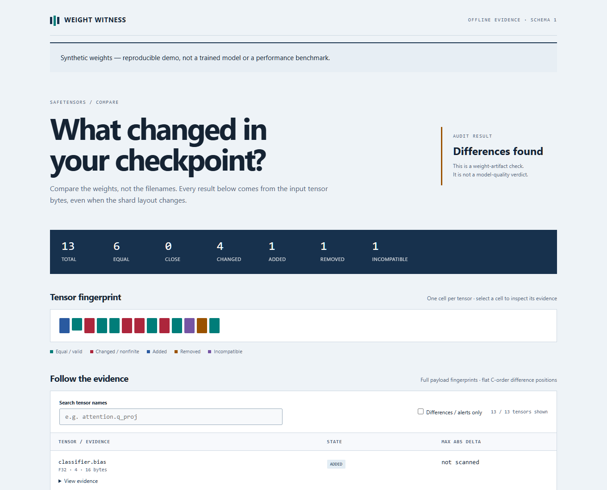

# Weight Witness

**What changed in your checkpoint? Follow the bytes.**

Audit local safetensors shard ownership and compare tensor values, without loading a model, importing PyTorch, executing pickle, or sending data anywhere.

[Live demo](https://gedouluhui.github.io/weight-witness/demo/) · [中文说明](README.zh-CN.md) · [Offline report](docs/demo/index.html) · [Machine-readable example](docs/demo/report.json) · [Design and boundaries](docs/DESIGN.md)

[](https://github.com/gedouluhui/weight-witness/actions/workflows/ci.yml)

> Experimental v0.1.0. Original code under MIT. No GPU or API key. No third-party runtime dependencies. A weight-artifact check is **not** a model-quality, provenance, or security verdict.



## The failure this catches

Two shards can each be valid safetensors files, and the combined tensor names can be correct, while the index points a tensor to **the wrong existing shard**. Weight Witness checks ownership in both directions rather than trusting the index or silently deduplicating keys.

It also compares tensors **by name**, so re-sharding an unchanged checkpoint does not look like a model change. A changed float gets a maximum absolute delta, RMSE, first worst flat index, nonfinite counts, and payload fingerprints. Shape and dtype changes are structural differences, never rounded away.

## Try it in two minutes

Python 3.10 or newer:

```sh
git clone https://github.com/gedouluhui/weight-witness.git
cd weight-witness
python -m pip install .
python examples/make_demo.py --output artifacts/demo

# Same tensor values, different shard layout: exit 0, status equal
weight-witness diff artifacts/demo/base artifacts/demo/resharded

# Actual weight changes: exit 1 is the EXPECTED result
weight-witness diff artifacts/demo/base artifacts/demo/candidate --json artifacts/diff.json --html artifacts/diff.html

# Individually valid files, incorrect shard ownership: exit 2
weight-witness inspect artifacts/demo/broken
```

Open `artifacts/diff.html` directly in a browser. Search tensor names, show differences only, select a tensor in the fingerprint strip, and expand its evidence. It works offline; all rows remain readable with JavaScript disabled. The generated demo is **synthetic**, not a trained language model. Choose a fresh output directory when rerunning the generator; it refuses to overwrite existing directories.

Prefer module invocation? Every command also works as `python -m weight_witness ...`. The project is not published to PyPI; `pip install weight-witness` is **not** the documented installation route.

## Use your own local checkpoint

```sh
weight-witness inspect ./model.safetensors --html ./audit.html
weight-witness inspect ./checkpoint/model.safetensors.index.json --json ./audit.json
weight-witness diff ./before ./after --atol 0.00001 --rtol 0.0001 --html ./changes.html
```

Directories resolve in this order: `model.safetensors.index.json`, `model.safetensors`, or exactly one `*.safetensors` file. Ambiguous directories fail rather than choosing an arbitrary file. Index shard values must be simple relative basenames; nested paths and symlinks are deliberately unsupported.

JSON is always written to stdout for completed analyses and input/operational errors. `--json` saves the same object; `--html` writes a standalone report. Output parents must exist. The CLI rejects outputs that alias a source checkpoint, a referenced shard, the index, or each other. Argument-usage errors also produce a JSON error and exit 2; help and version remain ordinary text output.

| Exit | Meaning |
|---|---|
| `0` | Structurally valid inspect with no detected nonfinite values in scanned dtypes, or equal/close diff |
| `1` | Differences, incompatible/missing/added tensors, or detected nonfinite floating values |
| `2` | Invalid/unsupported input, budget failure, or I/O error; **not** a partial success |

A CI job can simply run `weight-witness diff expected actual`. Choose tolerances for your numerical workflow; this tool does not guess them. An empty checkpoint is structurally legal, but its report explicitly says no tensor payloads were audited.

## Precise scope

- **Numerical scanning:** F32, F16 and BF16, decoded little-endian. Finite-pair metrics only; NaN and either infinity are separately counted and never pass, even when their bytes match.
- **Exact-byte-only types:** BOOL, U8/I8, U16/I16, U32/I32, U64/I64, F64, F8_E4M3 and F8_E5M2. No numerical-health claims for these types. Packed and unknown future dtypes are rejected.
- **Tolerance:** `abs(right - left) <= atol + rtol * abs(left)`. The left side is the reference. Both tolerances must be finite and nonnegative. `equal` means identical tensor payload hashes; `close` permits different bytes within the rule, including +0 versus -0.
- **Structure:** duplicate JSON keys, invalid Unicode, unsigned-64-bit dimension overflow, bad lengths, gaps/overlaps/trailing data, wrong shape byte counts, missing shards, duplicate or wrong ownership, and inconsistent declared total size are rejected.
- **Budgets:** 16 MiB per header/index, 100,000 tensors, 4,096 shards, at most 64 dimensions. Streaming chunks default to 1 MiB and are configurable from 1 byte to 64 MiB. Memory is O(header metadata + output rows + chunk), **not** constant memory in tensor count. Large header sets and HTML reports can still be expensive.
- **Snapshot assumption:** source size, mtime and inode/device are checked around reads. This detects ordinary changes, not a malicious concurrent writer. Use stable, immutable checkpoint copies. Reports expose payload and header hashes, not signed authenticity.
- **Privacy:** no networking or telemetry. Reports omit absolute input paths and arbitrary metadata values, but tensor/shard names can still be private. Inspect before sharing. An HTML report includes all tensor rows; a UI filter does not redact hidden rows.
- **Output atomicity:** each output replacement is atomic, but JSON and HTML are not one filesystem transaction. An OS failure during the second replacement can leave the first output updated.

Pure-Python scanning reads **all** supported float values. It favors portability and inspectability over throughput; no multi-billion-parameter or GPU performance claim is made. This is not a LoRA merger, quantization validator, training debugger, model evaluator, or replacement for the official loader.

## Python API

```python
from weight_witness.compare import inspect_checkpoint, compare_checkpoints
from weight_witness.report import render_html

report = compare_checkpoints("before", "after", atol=0.0, rtol=0.0)
assert report["status"] in {"equal", "close", "different"}
# Invalid or unsupported artifacts raise weight_witness.checkpoint.FormatError.
```

Reports are deterministic JSON-safe dictionaries (schema version 1); no timestamps or machine paths are injected. Tensor and source payloads are never modified. Public interfaces are experimental until a stable release.

## Verify it, don't trust the screenshot

```sh
python -m pip install .
python -m unittest discover -s tests -v

# Optional independent oracle, not a runtime dependency:
python -m pip install numpy safetensors
python -m unittest discover -s tests -p test_oracle.py -v
```

The oracle uses the official writer/reader, independently compares metrics with NumPy float64, and tests changed layouts and incorrect ownership. Without those optional packages, the oracle tests are marked skipped, not passed. Symlink rejection tests can skip on Windows without symlink privileges; CI provides a Linux path as well. See [verification notes](docs/VERIFICATION.md) for actual release checks and untested areas.

## Why another tool?

[Safetensors](https://huggingface.co/docs/safetensors/index) is the authoritative format and loader. [safetensors-cli](https://docs.rs/crate/safetensors-cli/0.1.0/source/src/main.rs) lists tensor metadata; [safetensors_explorer](https://docs.rs/crate/safetensors_explorer/0.2.0/source/src/explorer.rs) provides browsing; [huggingface_hub metadata APIs](https://huggingface.co/docs/huggingface_hub/package_reference/hf_api#huggingface_hub.HfApi.get_safetensors_metadata) inspect Hub-hosted metadata. Weight Witness focuses on a narrower offline handoff: **declared shard ownership + layout-independent value diff + a shareable evidence file**. It does not claim those tools lack all auditing features or that this workflow is globally novel.

Format reference: [safetensors 0.8.0](https://docs.rs/safetensors/0.8.0/safetensors/#format). Shard index reference: [Transformers shard metadata](https://huggingface.co/docs/transformers/main/en/big_models#shard-metadata).

## Contributing

A useful report includes a tiny synthetic reproducer, Python/package versions, expected outcome and actual JSON. **Do not upload private model weights or credentials.** Add a regression test with any fix. Contributions extending dtype/path support must include official-writer interoperability checks and a precise numerical policy.

This project was developed with AI assistance and independent code review. Test results demonstrate the covered cases, not universal correctness or real-user adoption.
